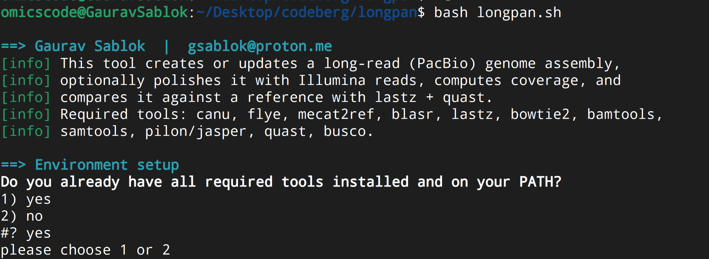

# longpan

- entire transcriptome assembly and genome assembly for pangenomics 
- uses all the genome assembly and alignment tools 
- Genome assembly using long reads and HiC. 




```
bash longpan.sh

```

Gaurav Sablok \
gsablok@proton.me
